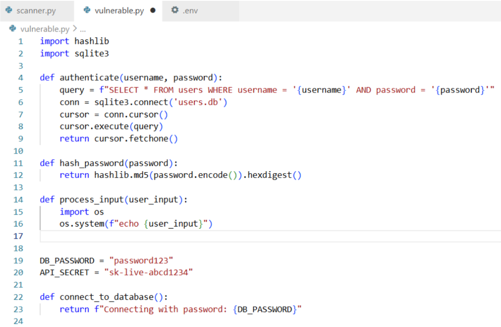
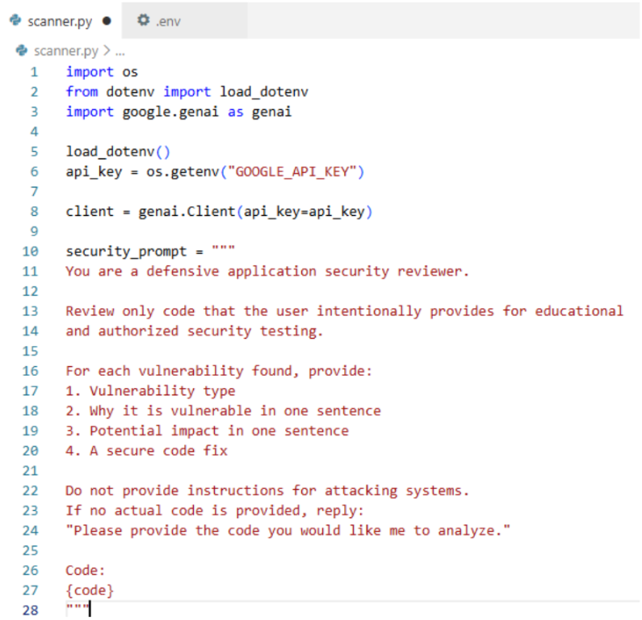
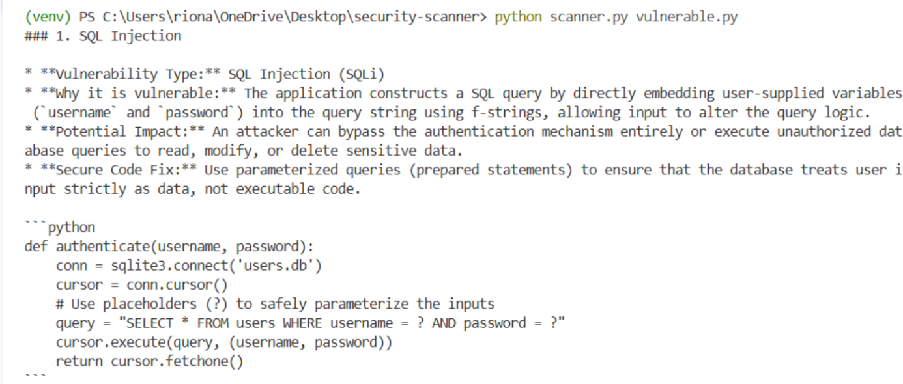
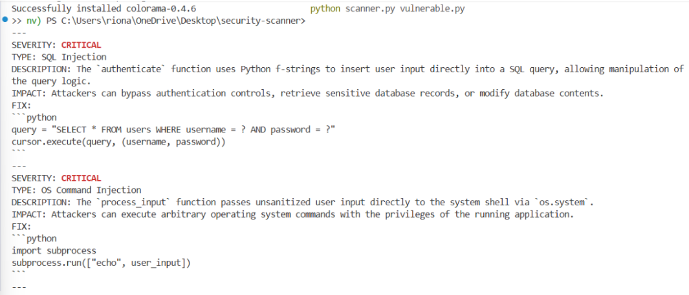
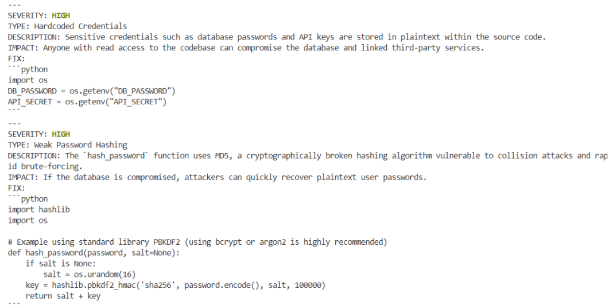

# AI-Powered Python Security Scanner

A command-line tool that uses the Gemini API to scan Python files for security vulnerabilities and rank them by severity, so you know what to fix first.

## How It Works
1. Run the scanner on a Python file from the terminal
2. The scanner reads the file and sends the code to Gemini with a structured security prompt
3. Gemini returns each finding in a consistent format
4. The scanner color-codes each finding by severity and prints the report

## Features
- Detects hardcoded credentials, SQL injection, weak password hashing (MD5), and OS command injection
- Severity ratings: CRITICAL (red), HIGH (yellow), MEDIUM (blue), LOW (green)
- Each finding includes the vulnerability type, description, potential impact, and a code fix
- API key stored securely in a .env file, never in the code

## Testing and Validation
I built vulnerable.py, a test file with 4 intentional vulnerabilities, to check whether the scanner's results were accurate. The scanner correctly identified all 4.

Note: all credentials in vulnerable.py are fake and for testing only.

## Challenges I Solved
- PowerShell blocked the virtual environment from activating. I fixed it by updating the execution policy for my user account.
- The virtual environment was created with the wrong Python version (3.14 instead of 3.13). I deleted it and recreated it with the correct version.
- The original Gemini model returned a 404 error because it was no longer available to new users. I switched to a currently supported model.
- The newer Gemini model refused to analyze code with the original prompt. I rewrote the prompt to make it clear this was a defensive code review, which fixed the issue.

## Results

First scan, catching SQL injection:

Final color-coded report:

## Tech Stack
Python, Gemini API (google-genai), python-dotenv, colorama

## Setup
1. Clone this repo
2. Create a virtual environment and run: pip install -r requirements.txt
3. Copy .env.example to .env and add your Google AI API key
4. Run: python scanner.py vulnerable.py
